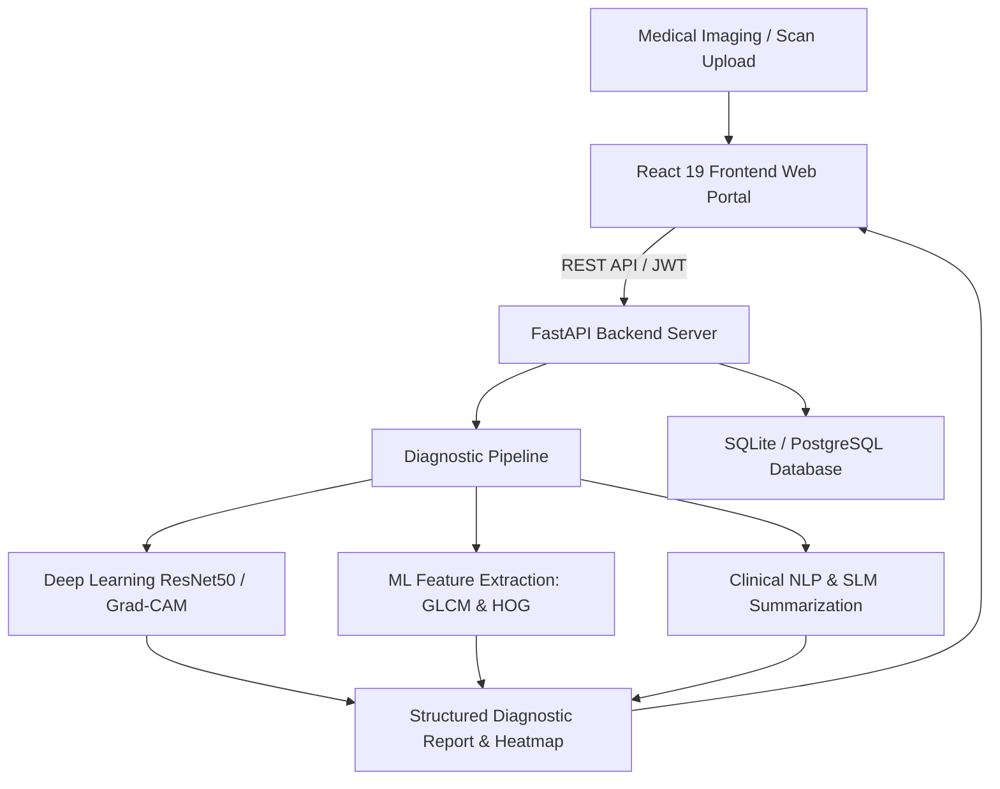

# 🏥 Automated Medical Image Analysis for Diagnosis

[](https://www.python.org/)
[](https://fastapi.tiangolo.com/)
[](https://react.dev/)
[](https://vitejs.dev/)
[](https://tailwindcss.com/)
[](LICENSE)

An intelligent, multi-modal clinical decision support system designed to assist radiologists and healthcare professionals in automated disease diagnosis from medical imaging (Chest X-Rays). The system pairs deep learning models with Grad-CAM visual explainability, Clinical NLP entity extraction, Small Language Models (SLM) for clinical summary reports, and a responsive web dashboard.

---

## 🌟 Key Features

- **Multi-Modal Diagnostic Engine:**
  - Automated detection of conditions including Pneumonia, Tuberculosis, COVID-19, Cardiomegaly, and Normal scans.
  - Deep Learning (ResNet50 / DenseNet) and Machine Learning (GLCM, HOG, SVM/RandomForest) feature pipelines.
- **Visual Explainability (Grad-CAM):**
  - Generates localized heatmaps highlighting pathological regions guiding model predictions for transparent diagnosis.
- **Clinical NLP & SLM Reporting:**
  - Extracts key clinical entities and generates structured radiology summary reports.
- **Doctor's Clinical Dashboard:**
  - Intuitive, modern React web interface for patient records, scan uploads, real-time diagnostic review, and PDF report export.
- **1-Click Master Launcher:**
  - Single script (`./run.sh`) to spin up both the FastAPI backend and React frontend with health monitoring.

---

## 🏛️ System Architecture



---

## 🚀 Quick Start Guide

### Prerequisites
- Python 3.10+
- Node.js 18+ & npm
- Git

### 1. One-Click Launch (Recommended)
Run the automated launcher from the project root:
```bash
chmod +x run.sh
./run.sh
```
This script frees busy ports, starts the FastAPI backend (`http://127.0.0.1:8000`), launches the React frontend (`http://127.0.0.1:3003`), and opens your default browser automatically.

---

### 2. Manual Setup

#### Backend (FastAPI)
```bash
# Activate Python Virtual Environment
source venv/bin/activate

# Install Dependencies
pip install -r backend/requirements.txt

# Start Backend Server
python -m uvicorn backend.app.main:app --host 127.0.0.1 --port 8000 --reload
```
- **API Docs (Swagger):** [http://127.0.0.1:8000/docs](http://127.0.0.1:8000/docs)
- **ReDoc:** [http://127.0.0.1:8000/redoc](http://127.0.0.1:8000/redoc)

#### Frontend (React + Vite)
```bash
cd frontend

# Install Node Dependencies
npm install

# Build & Run Preview Server
npm run build
npx vite preview --host 127.0.0.1 --port 3003
```
- **Frontend Portal:** [http://127.0.0.1:3003](http://127.0.0.1:3003)

---

## 🔑 Default Sign-In Credentials

- **Email:** Any clinical email (e.g., `radiologist@hospital.org`)
- **Password:** `Lakshmanan@2025`

---

## 📁 Repository Structure

```
.
├── backend/                  # FastAPI Application Service
│   ├── app/
│   │   ├── database/         # DB connection & models
│   │   ├── routers/          # API endpoints (auth, diagnosis, patients, reports)
│   │   ├── schemas/          # Pydantic validation schemas
│   │   └── services/         # ML/DL inference & processing services
│   ├── requirements.txt      # Python dependencies
│   └── Dockerfile
├── frontend/                 # React 19 + TypeScript + Vite Web Portal
│   ├── src/
│   │   ├── components/       # UI components & charts
│   │   ├── pages/            # Dashboard, Landing, Scan Upload, Reports
│   │   └── services/         # Axios API client
│   └── package.json
├── dl/                       # Deep Learning models & Grad-CAM explainability
├── ml/                       # Classical ML feature extractors (GLCM, HOG)
├── datasets/                 # Scan validators & sample datasets
├── database/                 # SQL schemas & migration scripts
├── docker/                   # Dockerfiles & Nginx configurations
├── docker-compose.yml        # Multi-container orchestration
├── run.sh                    # 1-Click Master Launch Script
└── README.md
```

---

## 🐳 Docker Deployment

To launch the full system with Docker Compose:
```bash
docker-compose up --build
```

---

## 📄 License
This project is licensed under the MIT License - see the [LICENSE](LICENSE) file for details.
